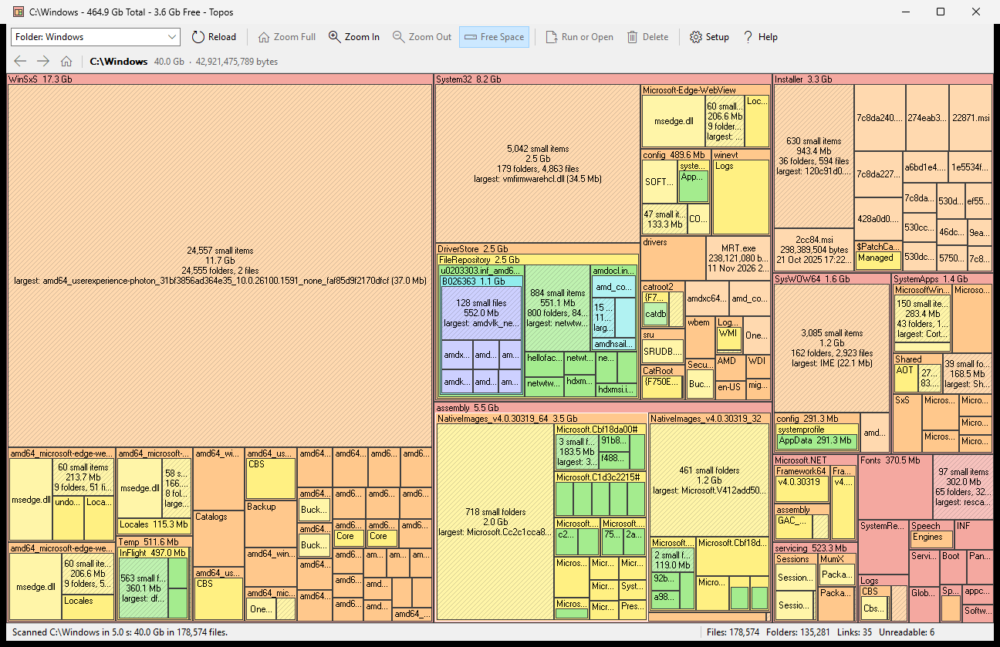

# Topos

[](https://github.com/bradwilliamson/Topos/actions/workflows/ci.yml)
[](#license)

Topos (like *topology*) is a disk-space treemap for Windows 10 and 11. Pick
a drive or folder and see every folder and file as a tile sized by what it
takes up, nested inside its folder. Zoom in and out, then open or delete
(to the Recycle Bin) straight from the map.

<picture>
  <source media="(prefers-color-scheme: dark)" srcset="docs/screenshot-dark.png">
  
</picture>

It is a small native program (about 1.8 MB, 64-bit and 32-bit) written in
safe Rust with a plain Win32 window, in the spirit of the classic
SpaceMonger view: drive picker, toolbar, nested map with title strips, a
free-space tile, and crisp 8-point captions, in a light or dark theme.

## Features

- **Fast.** A whole `C:\` drive (2.2 million files) scans in about 4
  seconds. The last scan of each drive is kept, so the next start shows a
  map in under a second while a fresh scan runs.
- **The whole tree at once.** Each folder with room gets a title strip
  with its name and size, and its contents are laid out inside it, several
  levels deep. Items too small to name share a hatched tile ("2,500 small
  files, 4.9 Mb").
- **Colour by depth or by file type**: video, audio, images, archives,
  programs, documents, code, and data, with a legend.
- **Light and dark themes** that follow Windows, with every caption meeting
  WCAG AA contrast (checked by tests). Screenshots:
  [light](docs/screenshot-light.png), [dark](docs/screenshot-dark.png).
- **Map-style navigation**: the wheel zooms into the folder under the
  pointer, Back and Forward history works like a browser's, and there is a
  breadcrumb and full keyboard control.
- **Safe delete.** Delete always goes to the Recycle Bin after a
  confirmation, and the map updates in place without a rescan.
- **Private.** No network code, telemetry, accounts, or update checks.

## Install

Get Topos from the
[latest release](https://github.com/bradwilliamson/Topos/releases/latest):

- **Installer**: `Topos-v<version>-x86_64-setup.exe`, or `-x86-setup.exe`
  for 32-bit Windows. It installs for you alone by default (no
  administrator rights) or for all users, adds a Start menu entry, upgrades
  in place, and uninstalls from Settings > Apps. Your settings and scan
  cache in `%LOCALAPPDATA%\Topos` are kept.
- **Portable zip**: `Topos-v<version>-x86_64-windows.zip`, or
  `-x86-windows.zip`. Unzip and run `Topos.exe`; nothing is installed.

The files are not code-signed, so SmartScreen may say "Windows protected
your PC". Check the download first, then choose **More info** and **Run
anyway**:

```powershell
Get-FileHash .\Topos-v0.1.0-x86_64-setup.exe   # compare with SHA256SUMS.txt
gh attestation verify Topos-v0.1.0-x86_64-setup.exe --repo bradwilliamson/Topos
```

The second line checks GitHub's build provenance: that the file was built
by this repository's release workflow from a tagged commit.

You can also [build Topos from source](#building).

## Using Topos

```powershell
Topos.exe                     # scan the first drive
Topos.exe D:\                 # scan a drive
Topos.exe "C:\Program Files"  # scan any folder (no free-space tile)
```

**Mouse**

- Rest the pointer on a tile for its name, exact size, last write time, and
  full path. The folder a double-click would open is outlined in blue.
- Click to select. Double-click a folder to zoom into it, or a file to zoom
  into its folder.
- The wheel zooms like a map: up goes one level into the folder under the
  pointer, down goes up one level.
- Mouse Back and Forward step through history.
- Right-click for Run or Open, Show in Explorer, zoom, and Delete.

**Keyboard** (with the map focused)

| Key | Action |
|---|---|
| Arrow keys | Move the selection between neighbouring tiles |
| Enter | Open the selection |
| Backspace, Alt+Up | Up one level |
| Alt+Left, Alt+Right | Back and Forward |
| Home | Show the whole drive or folder again |
| F5 | Rescan |
| Delete | Move the selection to the Recycle Bin |
| Escape | Stop a scan, or clear the selection |
| F1 | Using Topos (the in-app guide) |

**Setup** has the appearance (light, dark, or as Windows is set), map
density (Detailed, Balanced, or Simple), colouring by file type, the caption
font (MS Sans Serif, or Segoe UI with ClearType), and delete confirmation.
Choices are saved as you make them in `%LOCALAPPDATA%\Topos\settings.txt`.

## Performance

Whole `C:\` (2.23 million files, 402,000 folders), warm cache, on one
development machine:

| Program | First map | Up-to-date map | Peak memory |
|---|---|---|---|
| SpaceMonger 1.4 | 34.5 s | 34.5 s | 303.5 MB |
| Topos, first run | 4.8 s | 4.8 s | 205 MB |
| Topos, later runs | ~0.8 s (last scan) | 4.0–5.0 s | 356–361 MB |

Every pull request is checked: CI counts the instructions and heap of the
layout, map, painting, and scan-cache benches on the base commit and on the
change, and fails the change if any of them gets more than 1% (instructions)
or 2% (heap) worse. Method, per-folder numbers, memory layout, and
benchmarks are in [docs/performance.md](docs/performance.md).

## Safety and privacy

- Delete always moves the item to the **Recycle Bin**, never deletes
  permanently, and asks first unless that is turned off in Setup. If a scan
  or another delete finishes while the question is open, nothing is
  deleted.
- Scans only read. They never follow symbolic links or junctions, so they
  always finish, and a folder that cannot be read is drawn grey instead of
  stopping the scan.
- "Run or Open" hands the path to the shell as a single argument; no
  command interpreter parses file names.
- Topos itself contains no `unsafe` code (`#![forbid(unsafe_code)]`);
  Windows is reached through safe wrappers.
- Topos sends nothing anywhere. See [PRIVACY.md](PRIVACY.md).

To report a security problem, see [SECURITY.md](SECURITY.md).

## Building

Rust is pinned to **1.99.1** in `rust-toolchain.toml`, and `rustup` picks
it up. The program builds on Windows with the MSVC build tools:

```powershell
cargo build --release --target x86_64-pc-windows-msvc   # 64-bit
cargo build --release --target i686-pc-windows-msvc     # 32-bit
.\target\x86_64-pc-windows-msvc\release\Topos.exe
```

The library (scanner, tree, layout, map, and painting) is platform-free,
so its tests run anywhere with `cargo test`.
[CONTRIBUTING.md](CONTRIBUTING.md) lists the checks CI runs, and
[docs/architecture.md](docs/architecture.md) walks through the code.
Installers and packages are covered in
[packaging/README.md](packaging/README.md).

## License

Topos is licensed under either of the [MIT license](LICENSE-MIT) or the
[Apache License, Version 2.0](LICENSE-APACHE), at your option. Unless you
explicitly state otherwise, any contribution intentionally submitted for
inclusion in this project is licensed the same way.


Topos is a Tuigse LLC project. The Tuigse LLC name and emblem
(`assets/tuigse-emblem-256.bgra`, `docs/tuigse-emblem.png`) are Tuigse
LLC's marks. They are not licensed under MIT or Apache-2.0, so forks should
remove or replace them.
